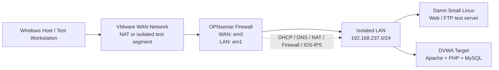
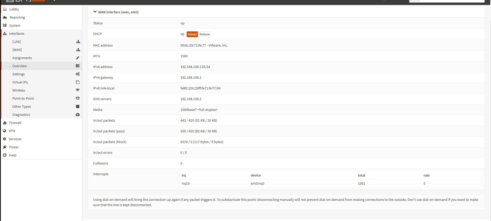
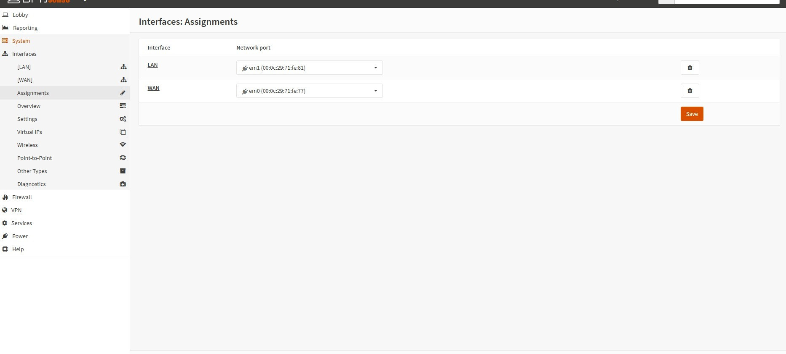
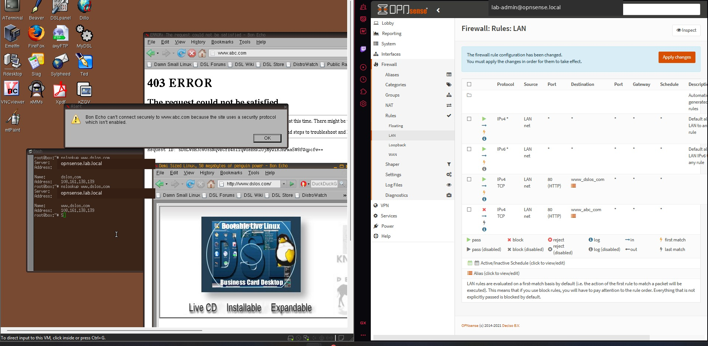
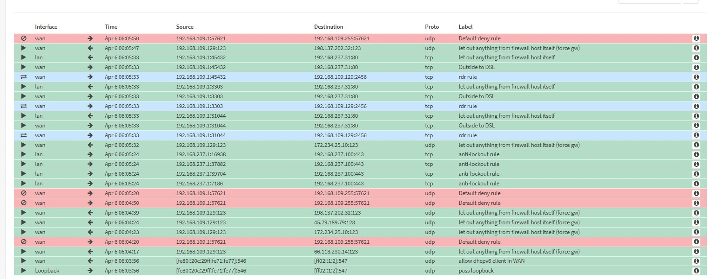
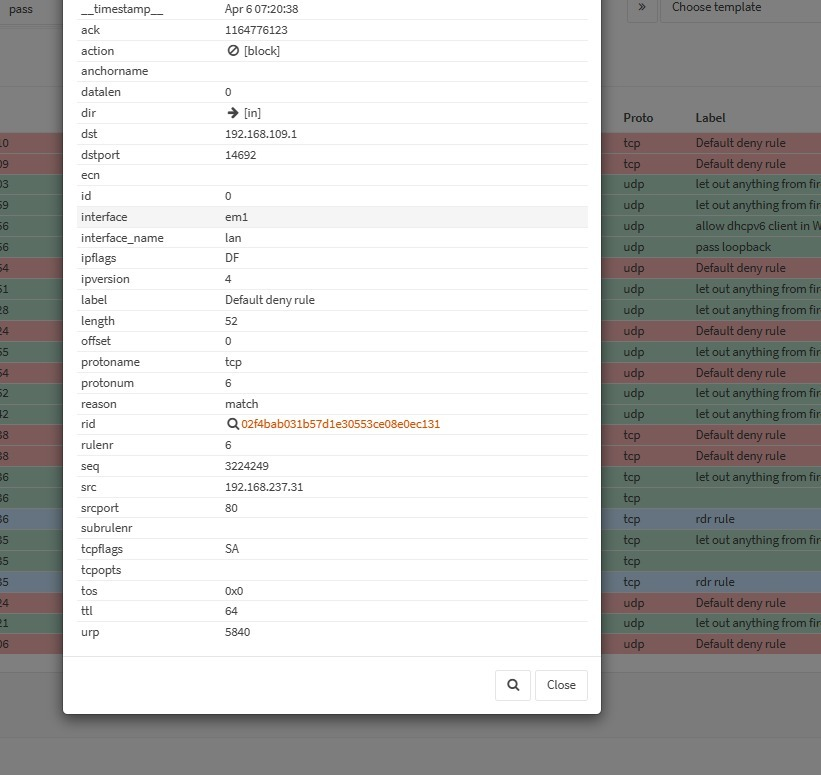
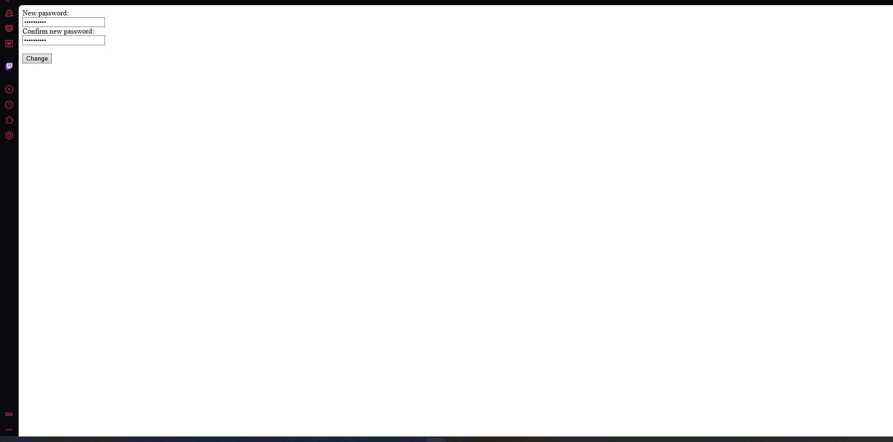
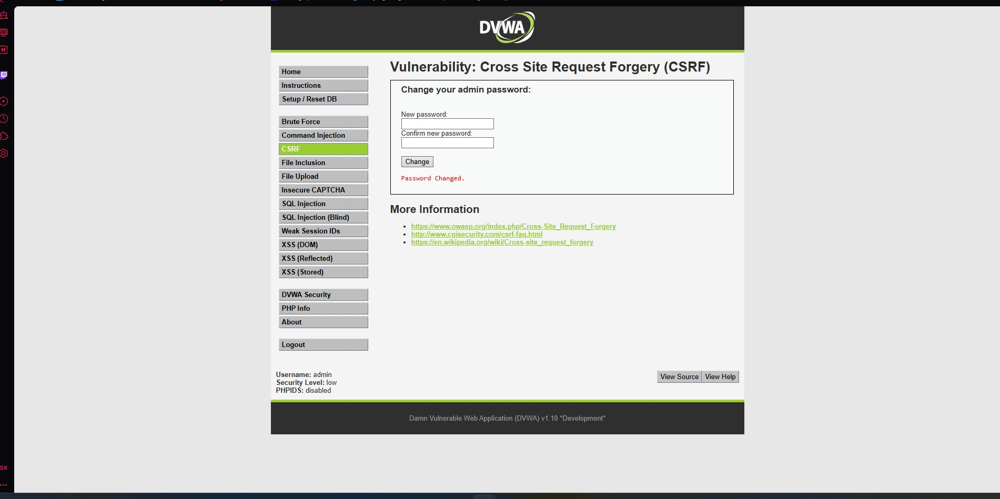

# OPNsense Network Security & DVWA Homelab

A reproducible, isolated security lab built around **OPNsense**, VMware virtual networks, a Damn Small Linux web server, and **DVWA**. The lab was used to configure and validate routing, DHCP/DNS, NAT, firewall policy, stateful inspection, protocol controls, traffic shaping, and Suricata-based IDS/IPS behavior. DVWA was used only as an authorized local target for controlled web-security validation.

> **Scope:** This repository documents a personal/academic homelab. It is separate from any employer or production environment. All addresses shown are private lab addresses, and the vulnerable systems must never be exposed to the public Internet.

## What this project demonstrates

- Built a dual-interface OPNsense firewall with separate WAN and LAN virtual networks.
- Assigned and validated WAN/LAN interfaces, routing, gateway, and DNS behavior.
- Replaced VMware DHCP on the isolated LAN with OPNsense DHCP.
- Created DNS host overrides and validated resolution from a LAN client.
- Published an internal web service through a nonstandard WAN port using NAT.
- Created destination-specific allow/block firewall policies and reviewed state/log evidence.
- Tested FTP, Telnet, SSH/PSCP, and traffic-control concepts in an isolated network.
- Configured a Suricata-based IDS/IPS workflow and documented EICAR alert/drop retesting.
- Used DVWA for controlled CSRF, XSS, and SQL-injection exercises across security levels.

## Evidence status

| Capability | Status | Evidence |
|---|---|---|
| WAN/LAN assignment | Verified | Interface and WAN screenshots |
| DHCP scope | Verified | OPNsense DHCP configuration |
| DNS lookup and overrides | Verified | OPNsense lookup plus client `nslookup` |
| NAT port forwarding | Verified | WAN port `2456` to internal HTTP service |
| HTTP allow/block policy | Partially verified | Rules and browser behavior captured; corrected retest procedure included |
| Firewall logs and state inspection | Verified | Live View and state-detail evidence |
| FTP/Telnet protocol tests | Partial | FTP service and firewall-log evidence; exact retest steps included |
| Traffic shaping with PSCP | Procedure documented | No user-generated shaper/throughput evidence was found in the supplied archive |
| Suricata IDS/IPS EICAR alert/drop | Procedure documented | Original EICAR screenshots were not present in the supplied archive |
| DVWA CSRF | Verified | Local form and successful password-change result |
| DVWA XSS and SQL injection | Procedure documented | Setup/troubleshooting evidence exists; complete exploit screenshots were not found |

## Lab architecture

The archived environment changed addresses during different lab iterations. The clearest final interface evidence shows OPNsense LAN `192.168.237.100/24`, DHCP pool `192.168.237.30-192.168.237.64`, and a WAN lease of `192.168.109.129/24` with gateway/DNS `192.168.109.2`. A later NAT-validation screenshot uses a different WAN-side address, demonstrating that the virtual lab was redeployed or readdressed.

## Selected evidence

### Interface and DHCP configuration

### NAT publication of the internal web server

The external test used TCP port `2456`, translated to the internal `MonkeyWeb` alias on HTTP port `80`.

### DNS override validation

The LAN client used the OPNsense LAN address as its DNS server and resolved a configured hostname to the expected address.

### Firewall policy and telemetry

### DVWA CSRF validation

## Documentation

1. [Architecture and addressing](docs/01-architecture-and-addressing.md)
2. [OPNsense build and interface setup](docs/02-opnsense-build-and-interfaces.md)
3. [DHCP and DNS](docs/03-dhcp-and-dns.md)
4. [NAT port forwarding](docs/04-nat-port-forwarding.md)
5. [Firewall policy and validation](docs/05-firewall-policy-and-validation.md)
6. [Protocol rules and traffic shaping](docs/06-protocol-rules-and-traffic-shaping.md)
7. [Suricata IDS/IPS and EICAR testing](docs/07-suricata-ids-ips-eicar.md)
8. [DVWA setup and isolation](docs/08-dvwa-setup-and-isolation.md)
9. [DVWA CSRF validation](docs/09-dvwa-csrf.md)
10. [DVWA XSS validation](docs/10-dvwa-xss.md)
11. [DVWA SQL-injection validation](docs/11-dvwa-sql-injection.md)
12. [Troubleshooting and lessons learned](docs/12-troubleshooting-and-lessons.md)
13. [Evidence map and missing captures](docs/13-evidence-map.md)
14. [GitHub publishing instructions](GITHUB_SETUP.md)

## Resume-ready description

> Built a virtualized OPNsense security lab with LAN/WAN routing, DHCP/DNS, NAT, protocol-specific firewall policies, and traffic-control testing; configured Suricata IDS/IPS and documented controlled alert/drop validation using an isolated DVWA and Linux test environment.

## Safety and ethics

Use this material only in systems you own or are explicitly authorized to test. Keep DVWA and other intentionally vulnerable services on an isolated host-only network. Do not bridge the vulnerable LAN directly to a production or public network. See [SECURITY.md](SECURITY.md).
