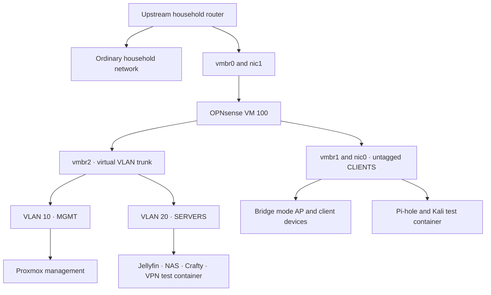

# Architecture and inventory

[Back to the project](../README.md)

## Physical host

The lab runs on a DreamQuest mini-PC with an Intel N95, 32 GB RAM, two Ethernet interfaces, and an approximately 1 TB internal SSD. A separate 16 TB hard drive connects through a USB-to-SATA adapter for shared data. All virtual infrastructure described here depends on this one host.

The ordinary household network remains on the upstream router. A second, protected Wi-Fi path uses a Linksys MX2000 in bridge/AP mode behind OPNsense. This arrangement was chosen to keep ordinary household routing outside the lab. A controlled whole-host shutdown test proving that separation was not retained.

The internal SSD contains the Proxmox system, guest storage, and the later backup logical volume. It is not a spare backup drive. Historical kernel logs identify an ATA/SATA storage path; an earlier assumption that an M.2 form factor guaranteed NVMe is not used here. No serial numbers or storage UUIDs are published.

## Network topology

The diagram describes the logical forwarding paths. OPNsense and all listed guest workloads run on the Proxmox host. WAN addressing and the host's upstream recovery address are intentionally omitted.

## Bridges and interfaces

| Object | Attachment | Implemented role |
| --- | --- | --- |
| `nic1` | Upstream cable | Physical port for `vmbr0` |
| `nic0` | Protected downstream cable | Physical port for `vmbr1` |
| `vmbr0` | `nic1`, OPNsense WAN NIC | Upstream/WAN bridge; later evidence also shows a host management address here |
| `vmbr1` | `nic0`, OPNsense CLIENTS NIC, CLIENTS guests | Untagged CLIENTS segment |
| `vmbr2` | No physical bridge port | VLAN-aware internal trunk carrying VLANs 10 and 20 |
| `vmbr2.10` | VLAN 10 on `vmbr2` | Proxmox MGMT interface |

The CLIENTS subnet ends in `.30`, but the recorded implementation is untagged. Subnet numbering does not create an 802.1Q tag. The internal trunk is virtual; the records do not establish an additional managed switch.

## Public address model

These addresses replace the private operational addressing consistently throughout the repository.

| Zone or service | Public example | Function |
| --- | --- | --- |
| MGMT | `10.42.10.0/24` | Administrative network |
| OPNsense MGMT | `10.42.10.1` | MGMT gateway |
| Proxmox MGMT | `10.42.10.10` | Web interface on TCP 8006 |
| SERVERS | `10.42.20.0/24` | Service network |
| OPNsense SERVERS | `10.42.20.1` | SERVERS gateway |
| Jellyfin | `10.42.20.10` | TCP 8096 |
| NAS | `10.42.20.20` | SMB on TCP 445 |
| Crafty and Minecraft | `10.42.20.30` | Observed application listeners on TCP 8443 and 25565 |
| VPN experiment | `10.42.20.40` | Test gateway container |
| CLIENTS | `10.42.30.0/24` | Protected clients, AP, DNS, and test client |
| OPNsense CLIENTS | `10.42.30.1` | CLIENTS gateway and Kea DHCP |
| Pi-hole | `10.42.30.2` | Filtering resolver |
| Kali test client | `10.42.30.4` | Historical single-client experiment address |

The test client's address appears inconsistently in later discussion. `.4` represents the explicit recorded container configuration and routing rule, not a guarantee of its latest address. The AP and administrator device addresses are omitted.

## Workload inventory

The state column refers to the **12 October inventory**, not a fresh health check. The table contains the workloads covered by this repository.

| ID | Type | Workload | Recorded placement | Inventory state |
| --- | --- | --- | --- | --- |
| 100 | VM | OPNsense | WAN, CLIENTS, internal trunk | Running |
| 101 | LXC | Pi-hole | CLIENTS | Running |
| 102 | LXC | Jellyfin | SERVERS VLAN 20 | Running |
| 103 | LXC | NAS and Samba | SERVERS VLAN 20 | Running |
| 104 | LXC | Crafty and Minecraft | SERVERS VLAN 20 | Running |
| 105 | VM | Kali | Final network configuration not recovered | Stopped |
| 106 | LXC | Kali test client | CLIENTS on `vmbr1` | Running |
| 107 | LXC | YouTube VPN experiment | SERVERS VLAN 20 | Running |

Older suggested CPU, memory, root-disk, and privilege settings are not copied into this inventory as verified configuration. OPNsense's foundation configuration is recorded as two cores, 4 GB RAM, and a 32 GB disk. Other exact allocations are included only where a specific result supports them.

## Management addressing changed after the master runbook

The 8 September continuation and 16 September master say that the old upstream Proxmox address was removed and the default gateway moved to OPNsense MGMT. However, **17 September user output shows both the upstream address on `vmbr0` and the MGMT address on `vmbr2.10`, with the upstream default gateway present**. A CLIENTS return route through OPNsense was also added; persistence was not confirmed.

This later observation prevents a reliable claim that upstream management remained removed. No later complete host network export was recovered. The network topology and MGMT interface are established, but the final default route, upstream host exposure, and persistent return-route configuration remain unresolved.

This edition deliberately provides no replacement `/etc/network/interfaces` file. A reconstructed “final” file would conceal the contradiction and could remove a working access path.

Two management addresses can be useful during recovery. Two addresses in a document are not proof that either will survive the next outage.
