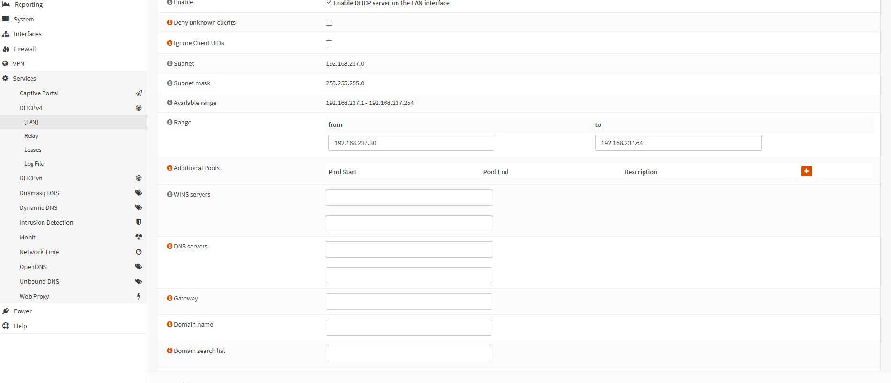
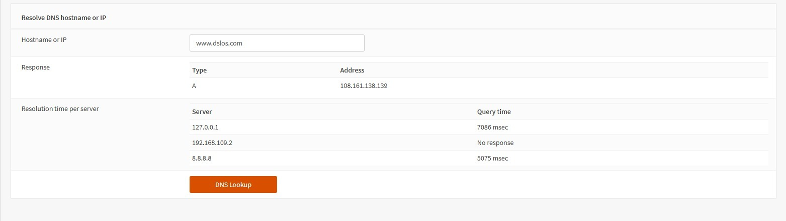
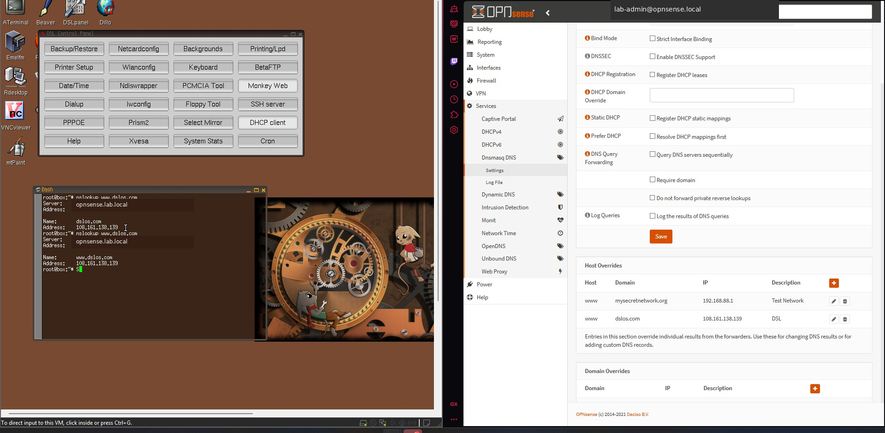

# 3. DHCP and DNS

## DHCP configuration

1. Disable VMware DHCP on the host-only LAN network.
2. In OPNsense, open **Services → DHCPv4 → LAN**.
3. Enable DHCP for the LAN interface.
4. Use a range inside the LAN subnet that excludes the firewall and any static systems.
5. The archived configuration used:
   - Network: `192.168.237.0/24`
   - Range: `192.168.237.30` through `192.168.237.64`
6. Supply the OPNsense LAN address as both the default gateway and DNS server.
7. Save and apply.



## Client renewal

Linux:

```bash
sudo dhclient -r
sudo dhclient -v
ip addr
ip route
```

Windows:

```powershell
ipconfig /release
ipconfig /renew
ipconfig /all
```

## DNS resolver/forwarder

The lab used OPNsense DNS services and host overrides.

1. Open **Services → Dnsmasq DNS** or **Services → Unbound DNS**, depending on the installed version.
2. Enable the DNS service on the LAN.
3. Add host overrides for test names.
4. Save and apply.
5. Validate from OPNsense Diagnostics first.
6. Validate from a LAN client using OPNsense as the DNS server.

Example:

```bash
nslookup www.dslos.com 192.168.237.100
```





## Success criteria

- The client receives its address, gateway, and DNS from OPNsense.
- The host override resolves to the expected address.
- A packet capture or live log shows DNS crossing the expected interface.
- No VMware DHCP lease competes with the OPNsense lease.
