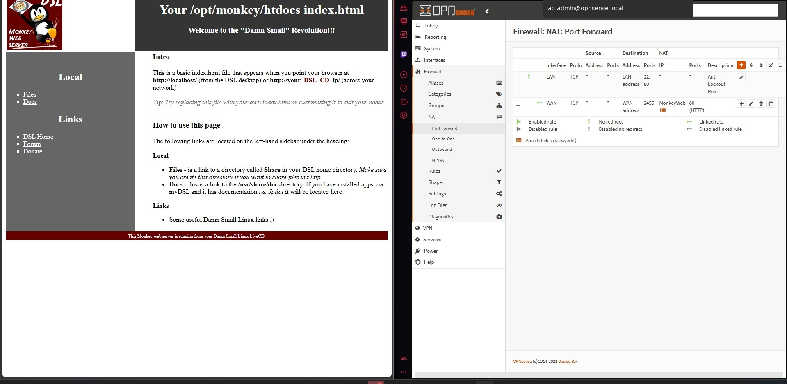

# 4. NAT Port Forwarding

## Objective

Publish the internal Linux web service through a nonstandard WAN port without exposing the OPNsense GUI or directly forwarding WAN port 80.

## Design

- WAN listener: TCP `2456`
- Internal target: `MonkeyWeb` alias
- Internal target port: TCP `80`

## Procedure

1. Confirm the internal Linux web server is reachable from the LAN.
2. Give the server a stable DHCP reservation or update the alias whenever its address changes.
3. Open **Firewall → Aliases** and create an alias named `MonkeyWeb` containing the internal web-server address.
4. Open **Firewall → NAT → Port Forward** and create a rule:
   - Interface: WAN
   - Protocol: TCP
   - Source: any, or limit it to the WAN-side test workstation
   - Destination: WAN address
   - Destination port: `2456`
   - Redirect target IP: `MonkeyWeb`
   - Redirect target port: `80`
   - Filter rule association: add associated rule
   - Logging: enabled for validation
5. Save, apply, and verify the associated WAN rule.
6. From the WAN-side workstation, test the WAN address on port `2456`.

```powershell
Test-NetConnection <OPNSENSE_WAN_IP> -Port 2456
curl.exe -I http://<OPNSENSE_WAN_IP>:2456/
```

## Negative control

Before or after the test, confirm that direct WAN access on port 80 does not publish the internal server. This distinguishes the translated service from the firewall management page and proves the nonstandard port is required.

## Evidence




The evidence shows the internal Monkey Web Server loading through the WAN-side test and the matching OPNsense port-forward rule translating port `2456` to HTTP port `80`.
