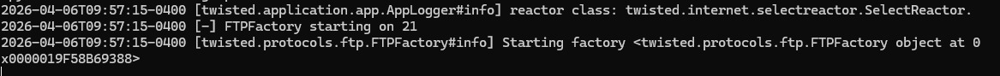

# 6. Protocol Rules and Traffic Shaping

## FTP validation

1. Start a controlled FTP server on the WAN-side workstation or another lab host.
2. Create a LAN rule allowing TCP port 21 from the Linux test client to only that server.
3. When using passive FTP, permit the configured passive port range or use a test implementation that keeps the ports explicit.
4. Connect from the Linux client and run a directory listing or transfer a harmless text file.
5. Verify the session in Live View and the state table.



## Telnet validation

Telnet was used only to demonstrate protocol-specific policy behavior in a closed lab. It should never be used for administrative credentials in a real environment.

1. Add a narrowly scoped TCP/23 rule to a controlled lab service.
2. Connect from the LAN client.
3. Confirm the pass action in Live View.
4. Disable or delete the rule after testing.

## SSH/PSCP and traffic shaping

1. Enable SSH on the internal test host.
2. Create a shaper pipe with a deliberately low bandwidth ceiling.
3. Create a queue attached to the pipe.
4. Create a shaper rule matching the test transfer, such as TCP/22 between the workstation and lab server.
5. Apply the shaper configuration.
6. Transfer a harmless file using PSCP or SCP.
7. Record transfer throughput with the shaper enabled.
8. Disable the shaper rule and repeat as a control.
9. Compare throughput and verify the flow in OPNsense telemetry.

Example:

```powershell
pscp.exe .\test-file.txt user@<LAB_SERVER_IP>:/tmp/
```


## Evidence limitation

The supplied archive contained a course-reference image explaining PSCP rather than a user-generated result, and it did not contain the active OPNsense pipe, queue, rule, and measured transfer in one capture. That reference image was intentionally excluded. The procedure above is documented for reproduction, but a new split-screen capture is required before claiming an evidenced shaping result.
