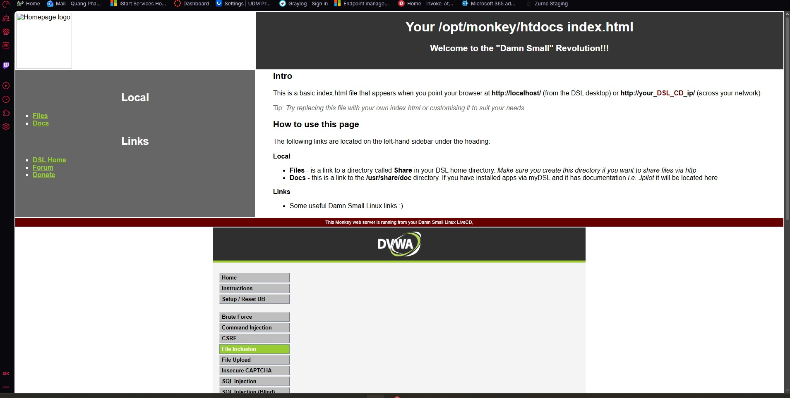

# 8. DVWA Setup and Isolation

## Purpose

DVWA is an intentionally vulnerable PHP/MySQL application used here as an authorized target for web-security exercises. It contains real vulnerabilities and must remain isolated.

## Recommended placement

- One NIC only, connected to the OPNsense-protected LAN.
- No bridged adapter.
- No public DNS record or public port forward.
- Take a VM snapshot before each exercise.
- Reset the database after destructive tests.

## Installation options

### Existing training VM

Import the authorized training image and connect it only to the isolated LAN.

### Local Apache/PHP/MySQL build

1. Install Apache, PHP, and MySQL/MariaDB on a disposable VM.
2. Place DVWA in the web root.
3. Copy and edit its configuration file with a dedicated lab database account.
4. Create/reset the database from the DVWA setup page.
5. Log in with the configured lab credentials.
6. Set the security level required for the exercise.

## Network validation

From the OPNsense LAN or a separate attack VM:

```bash
ping -c 2 <DVWA_IP>
curl -I http://<DVWA_IP>/dvwa/login.php
```

Do not publish DVWA through the NAT rule used for the benign Monkey Web Server.



## Exercise boundaries

This repository documents only controlled tests against the local DVWA target:

- CSRF password-change demonstration
- Reflected, stored, and DOM XSS demonstrations
- Manual and tool-assisted SQL-injection validation
- Troubleshooting of MySQL file-access restrictions
