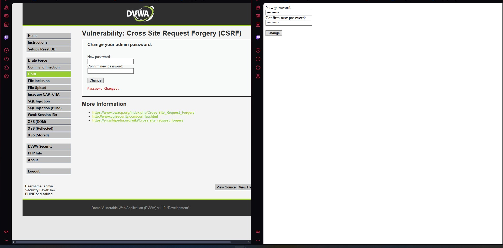

# 9. DVWA CSRF Validation

## Goal

Demonstrate that an authenticated browser can be induced to submit a password-change request without a per-request anti-CSRF token at DVWA's vulnerable security level.

## Procedure

1. Log in to the isolated DVWA instance.
2. Set the DVWA security level to **Low**.
3. Open the CSRF page and perform one normal password change while observing the request parameters.
4. Create a local HTML file based on [the included example](../examples/csrf-demo.html).
5. Replace `DVWA_IP` with the isolated target address.
6. Keep the authenticated DVWA session open in the same browser.
7. Open the local HTML file and submit the form.
8. Return to DVWA and verify the password changed.
9. Reset the test account and database when finished.

## Evidence

## Why it worked

At the vulnerable level, the application accepted a state-changing request based on the user's existing authenticated session without requiring an unpredictable CSRF token tied to that session and request.

## Mitigations

- Use POST for state-changing actions.
- Require a cryptographically random anti-CSRF token.
- Validate Origin/Referer where appropriate as defense in depth.
- Use `SameSite` cookies.
- Require current-password confirmation or reauthentication for sensitive changes.
- Avoid accepting password changes through query-string parameters.
